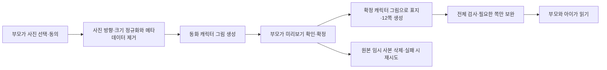

# 부모 사진 → 동화 캐릭터 → 책 생성 경로 검토

> 아래는 구현 전 조사 기록이다. 사용자가 대표 캐릭터 선확정과 고정 재사용을 승인했다. 이후 구현 상태와 확정 계약은 [사진 캐릭터 흐름](PHOTO_CHARACTER_FLOW.md)을 따른다.

2026-09-06. 부모가 사진을 올려 아이를 닮은 동화 캐릭터를 만들고, 그 캐릭터로 책을 생성한다는 제품 의도를 기준으로 코드와 공식 문서를 확인했다. **구현 가능한 경로가 있다. 현재 사진 경로에는 부모가 승인할 대표 캐릭터 그림을 먼저 생성하는 단계가 빠져 있다.** 이번 작업은 조사와 설계이며 앱 코드·API 설정·계정·실제 사진을 변경하거나 외부 AI를 호출하지 않았다.

## 현재 코드에서 확인한 실제 흐름

| 단계 | 실제 구현 | 근거 |
|---|---|---|
| 사진 분석 | 받은 사진 bytes를 글쓰기와 같은 `llm_provider`의 비전 기능으로 보내 외모·의상 JSON을 받음 | `apps/api/src/services/photo_character.py:97` |
| 캐릭터 저장 | 외형 설명과 `source_image_url`을 저장. 사진은 비공개 S3 호환 저장소에 보관 | `apps/api/src/routers/characters.py:703`, `:726` |
| 캐릭터 그림 | 사진 경로에는 대표 그림 생성·부모 미리보기 승인 단계와 영속 참조 자산 필드가 없음 | `apps/api/src/models/db.py:261`, `apps/api/src/routers/characters.py:669` |
| 신규 책 생성 | Gemini 경로는 원본 사진을 표지와 각 페이지의 참조로 사용. 생성 중 품질 수정도 원본을 사용 | `apps/api/src/services/orchestrator.py:490`, `:751`, `:819` |
| 완성 후 수정·검수 | 완성된 책의 나중 부분 수정은 표지를 참조. 전체 삽화 검수는 생성된 그림만 OpenAI로 보냄 | `apps/api/src/services/illustration_quality_edits.py:232`, `apps/api/src/services/image_quality.py:184` |

정상 첫 시도의 12쪽 책이라면 사진 분석 1회와 표지·본문 이미지 요청 13회에 사진이 사용될 수 있다. 재시도·생성 중 품질 수정은 별도다. 이번에는 비밀 환경파일을 읽지 않았으므로 현재 실서비스 제공자 선택값이나 실제 전송 이력을 단정하지 않는다.

기존 OpenAI 이미지 어댑터는 텍스트 기반 `/v1/images/generations`를 사용하며 참조 입력을 전달하지 않는다. 모델 이름만 바꾸는 것으로 사진·캐릭터 참조 방식이 완성되지 않는다(`apps/api/src/services/image.py:49`, `:100`).

## 권장 제품 흐름

- 캐릭터에 원본과 별개인 대표 그림, 준비 상태, 부모가 승인한 버전을 저장한다. 표지·페이지·부분 수정 모두 동일한 승인 버전을 참조한다.
- 원본을 삭제해도 `from_photo` 등 파생 이력은 유지한다. 사진에서 나왔다는 사실을 지우거나 일반 텍스트 캐릭터로 위장하지 않는다.
- 참조 그림을 읽지 못하면 부모에게 재시도를 안내하고 생성 완료를 막는다. 닮음 기능에서 참조 없이 조용히 생성하는 fallback은 사용하지 않는다.
- 원본 삭제 시점은 우리 서비스의 임시 사본에 대한 제안이다. 사용자의 사진 보관함 원본을 삭제하지 않는다. 외부 제공자의 내부 보관까지 즉시 삭제된다고 약속하지 않는다.
- 원본을 보내는 단계는 줄어들지만, 캐릭터 그림의 재전송 자체가 없어지는 것은 아니다. 아이와 연결되는 파생 이미지도 보호할 자료로 다룬다.

## 제공자·실행 환경 선택

### A. 승인된 OpenAI 이미지 API — 기존 연결을 활용하는 우선 후보

GPT Image는 이미지 입력을 활용한 편집을 지원하고, `gpt-image-2` 등을 사용하는 이미지 생성은 ZDR 호환이다. 공식 Under-18 지침은 13세 미만 또는 해당 디지털 동의 연령 미만 아동 개인정보 처리 전에 ZDR을 요구한다. ZDR은 사전 승인과 조직/프로젝트 적용 확인이 필요하다. 부모가 대신 입력하는 경우의 면제는 확인하지 못했다. 이 계정의 승인 상태·이미지 기능 접근 가능 여부도 미확인이다. [이미지 기능](https://developers.openai.com/api/docs/guides/image-generation), [아동 지침](https://developers.openai.com/api/docs/guides/safety-checks/under-18-api-guidance), [보관·승인](https://developers.openai.com/api/docs/guides/your-data)

이미지의 안전성 탐지에 따른 별도 검토·보관 예외가 있으므로 ZDR을 절대적인 모든 데이터 무보관으로 설명하지 않는다. 공식 문서도 여러 생성 사이 인물 일관성이 완벽하지 않을 수 있음을 명시하므로, 캐릭터 승인과 별개로 12쪽 전체 검사는 유지한다. [보관 예외](https://developers.openai.com/api/docs/guides/your-data), [이미지 한계](https://developers.openai.com/api/docs/guides/image-generation)

구현할 때 사진 분석 제공자를 글쓰기 제공자와 분리하고, 이미지 편집 어댑터에 승인 캐릭터 참조를 추가한다. 아동 자료가 들어가는 사진 분석·그림 생성·그림 검수 전체의 설정을 확인한다. `store=false` 한 줄이나 조직 인증만으로 ZDR 승인을 대신하지 않는다.

### B. 공개 모델을 자체 실행 — 외부 생성 API 승인에 의존하지 않는 대안

Qwen의 공식 `Qwen-Image-Edit-2509` 모델 카드는 Apache 2.0 라이선스와 이미지 편집·인물 및 만화 캐릭터 일관성 기능을 명시한다. 모델을 우리가 관리하는 GPU 환경에 배치해 사진→캐릭터 변환과 페이지 생성에 사용하는 설계를 검토할 수 있다. 이는 제조사 설명에 근거한 후보이며 이 프로젝트에서의 닮음·수채화 품질·처리 속도는 아직 측정하지 않았다. [공식 모델 카드](https://huggingface.co/Qwen/Qwen-Image-Edit-2509/blob/main/README.md)

이 경로는 사진뿐 아니라 아이를 닮은 캐릭터·완성 그림의 검수도 같은 통제 영역에서 처리해야 외부 이미지 API로 아동 자료가 나가지 않는다. 현재 OpenAI 삽화 검사를 그대로 두고 “사진 정보가 외부 AI로 나가지 않는다”고 주장할 수 없다. 외부 글쓰기 AI를 쓴다면 실제 이름·사진·식별 가능한 설명을 빼고 가상 설정으로 요청하고, 이름 반영은 우리 앱/서버에서 처리하도록 별도 설계한다.

GPU 비용·모델 라이선스와 종속 구성·유해물 검사·저장소·운영자 접근·클라우드 위탁 조건을 운영자가 관리해야 한다. Vercel·Supabase 연결만으로 이 이미지 연산이 준비되는 것은 아니다. 외부 관리형 추론 API에 모델 이름만 지정하는 것은 자체 실행과 다르다. 실제 사진 전에 합성 자료로 품질과 비용을 비교하고 운영 적합성을 판단한다.

### 추가 확인한 경로

- **부모 전용 서비스와 Google:** API 계정을 부모만 쓰는지와 아이가 결과 앱을 이용하는지를 구분해야 한다. Gemini API·Google Cloud 생성형 AI 약관은 미성년자 대상/접근 가능 서비스를 제한하며 부모 계정 예외를 명시하지 않는다. 실제로 부모 전용 제작 도구라면 그 실제 흐름을 제시해 적용 여부를 확인할 수 있으나, 명칭만 바꾸거나 부모 확인창만 넣어 허용됐다고 판단하지 않는다. [Gemini 약관](https://ai.google.dev/gemini-api/terms), [Google Cloud §20(d)](https://cloud.google.com/terms/service-terms)
- **Azure OpenAI:** 이미지 편집 기능과 미성년자 실사 생성에 대한 기능 신청 경로가 있다. 그러나 아이 사진 입력→동화 출력의 승인 범위와 남용 감시 보관 제외는 별도 확인이다. 일반 계정 개설만으로 충족한다고 단정할 수 없어 즉시 전환안으로 선택하지 않았다. [이미지 기능](https://learn.microsoft.com/en-us/azure/foundry/openai/how-to/dall-e), [보관](https://learn.microsoft.com/en-us/azure/foundry/responsible-ai/openai/data-privacy), [승인 자격](https://learn.microsoft.com/en-us/azure/foundry/responsible-ai/openai/limited-access)
- **기기 내 변환:** Apple은 Core ML 기반 이미지 변환 구현을 제공한다. 실제 기기별 메모리·속도·모델 라이선스와 Android 구현을 별도로 검증해야 하므로 단기 출시의 기본 경로로 가정하지 않았다. 기기에서 그림으로 바꿨다고 외부에 보내는 결과가 자동 익명 정보가 되는 것도 아니다. [Apple 구현](https://github.com/apple/ml-stable-diffusion/blob/main/README.md)

## 실제 사진 검증 전에 함께 수정할 부분

아래는 실행 재현을 마치지 않은 **정적 코드 감사 결과**이며, 재현 테스트와 수정이 필요하다. 이전의 테스트용 AI E2E 통과가 이 사진 경로의 완성을 증명하지 않는다.

1. 서버에서 받은 사진의 디코딩·재인코딩과 EXIF/GPS 제거를 명시적으로 수행해야 한다. 현재 MIME·크기 검사 후 bytes를 그대로 처리한다(`characters.py:71`).
2. 개별 사진 캐릭터 삭제에서도 저장소 삭제 실패를 영속 재시도 큐에 남겨야 한다. 현재 DB 삭제 후 스토리지 실패 목록을 처리하지 않는다(`characters.py:558`).
3. 사진 캐릭터가 없는 경우에도 동의 철회 UPDATE를 커밋해야 한다. 현재 파기 helper의 조기 반환과 호출자의 commit 부재를 확인했다(`consent.py:206`, `:275`).
4. 캐릭터 행 삭제 이후에도 파생 책·이미지를 찾을 수 있는 출처 기록을 보존해야 한다. 앱의 임시 선택 사진도 성공·실패·취소에서 정리한다.

## 다음 실행 단위

1. 원본/대표 캐릭터 그림/승인 상태를 분리하고 위 삭제·동의 결함을 재현·수정한다. 외부 AI 없이 검증할 수 있다.
2. 합성 사진과 가상 이름으로 대표 그림→12쪽→검수·부분 수정의 품질·시간·비용을 비교한다. OpenAI 경로는 계정 조건 확인, 자체 실행 경로는 GPU와 검수 모델의 적합성 확인을 병행한다.
3. 실제로 선택·확인된 조건에서 보호자가 제공한 사진을 사용한다. 처음에는 적은 입력으로 닮음·인물 일관성·그림 오류·메타데이터 제거·삭제를 확인한 뒤 독립 표본을 늘린다.

이번 조사로 기술 경로를 확인했으며 제공자 승인·실제 사진 품질·운영 적법성의 최종 확인을 완료한 것으로 표시하지 않는다. 스토어 등록 전 공동 검토 방침은 유지한다.
